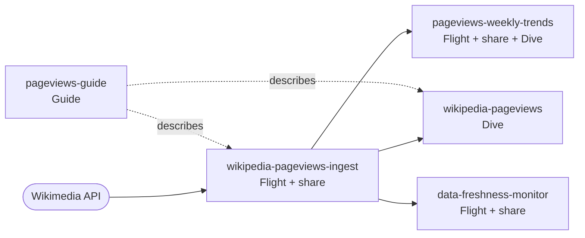

# Examples

Each example is a working package built on public data, so it deploys without credentials for any outside system. The Wikipedia starter is active in a new repository. The others live under `examples/`, which Blueprints does not discover, until you copy one into a package root.

## Choose by what you are building

| You want to | Start from | It shows |
| --- | --- | --- |
| Load data from an API on a schedule | [Wikipedia pageviews](wikipedia-pageviews.md) (`flights/wikipedia-pageviews-ingest`) | Incremental load, retries, a published share |
| Put a dashboard on data another package owns | [Wikipedia pageviews](wikipedia-pageviews.md) (`dives/wikipedia-pageviews`) | A Dive that reads a producer through an input |
| Build reporting tables with SQL | [Pageviews weekly trends](../../examples/pageviews-weekly-trends/README.md) | A transformation Flight that reads one database and rebuilds another, plus its Dive |
| Know when data is stale or missing | [Data freshness monitor](../../examples/data-freshness-monitor/README.md) | Hourly checks, a results table, failed runs, optional webhook alerts |
| Give agents and analysts context about a dataset | [Pageviews Guide](../../examples/pageviews-guide/README.md) | A Guide with catalog, Flight, and Dive references |
| Ship a pipeline, share, and dashboard as one unit | [NCS field recovery](ncs-field-recovery.md) | A `projects/` package with one lifecycle |

## How the examples fit together

The starter and three of the examples form one small data platform. Arrows are declared `inputs` or references, which is how Blueprints knows the deployment order.



In a pull request, every package in this graph deploys as a branch-scoped preview that reads the preview copy of its upstream, so a change to the ingest is tested together with everything that depends on it.

## Enable an example

Copy the directory into the package root that matches it, then validate:

```bash
cp -R examples/pageviews-weekly-trends projects/pageviews-weekly-trends
cp -R examples/data-freshness-monitor flights/data-freshness-monitor
cp -R examples/pageviews-guide guides/pageviews-guide
cp -R examples/ncs-field-recovery projects/ncs-field-recovery
make validate
```

Create a root that does not exist yet with `mkdir -p`. Each example's README lists the packages it depends on and what to change to use your own data.

## Practices the examples share

- **One database per pipeline, published as a share.** A share covers a whole database, so a Flight writes to a database named for its data and dashboards read the share.
- **Declared dependencies.** A package that reads another declares an `input`. Names come from `${inputs.<key>.database}`, never from a literal, so previews stay isolated from production.
- **Reruns are safe.** Loads replace the rows they cover and transformations rebuild their tables, so running a Flight twice gives the same result.
- **Config holds no secrets.** Credentials are Flight secrets, listed by name under `secrets`. Config is validated in the Flight because whoever starts a run can override it.
- **Flights attach only what they use.** They connect with `attach_mode=single` and attach other databases explicitly, which shortens startup.
- **The work stays in SQL.** Flights send statements to MotherDuck and stage files under `/tmp`, without row-by-row inserts.
- **Previews are private and temporary.** Preview shares are `RESTRICTED` and `HIDDEN`, schedules are off, and cleanup drops the preview database.
- **Pinned dependencies.** Every `requirements.txt` pins `duckdb` to the version Blueprints deploys with.
