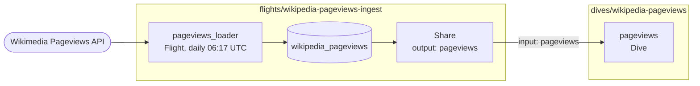

# Wikipedia Pageviews Example

This is the starter that a new repository deploys. A Flight loads public Wikimedia data every day and publishes it as a share; a Dive in a separate package reads that share.



The two packages show cross-blueprint composition:

```text
flights/wikipedia-pageviews-ingest/
  blueprint.yml
  src/flight.py
dives/wikipedia-pageviews/
  blueprint.yml
  src/dive.tsx
```

## Contract

The producer loads Wikimedia data, publishes the `wikipedia_pageviews` share, and exports it as `pageviews`:

```yaml
outputs:
  pageviews:
    share: pageviews
```

The Dive consumes that stable output without owning or duplicating the ingestion pipeline:

```yaml
inputs:
  pageviews:
    blueprint: wikipedia-pageviews-ingest
    output: pageviews

resources:
  dives:
    pageviews:
      requiredResources:
        - input: pageviews
          alias: wikipedia_pageviews
```

## What It Deploys

The producer package deploys the Flight and share. The consumer package deploys the Dive with `ready` status in production and `draft` status in preview.

The Flight creates or updates:

- database: `wikipedia_pageviews`
- schema: `main`
- table: `main.pageviews_daily`
- view: `main.pageviews_article_summary`
- share: `wikipedia_pageviews`

The Dive queries that output through the `wikipedia_pageviews` alias. After each load, the Flight runs `UPDATE SHARE` so consumers read the latest snapshot.

The public data comes from Wikimedia's Pageviews API. The defaults load `DuckDB`, `MotherDuck`, and `Wikipedia` for the last 30 complete days.

## Deployment Behavior

Both packages are discovered recursively by `motherduck.yml`. On preview, selecting either package expands to the complete connected graph: the branch-scoped Flight runs, its share becomes available, and the Dive deploys against that preview output as `draft`.

For branch `feature/mock-test`, the share and database render as:

```text
wikipedia_pageviews_preview_feature_mock_test
```

In a stable target, a producer change also redeploys the Dive and reconciles its declared `ready` status. A Dive-only change uses the existing output and does not rerun the Flight. If staging is configured, the staging share renders as `wikipedia_pageviews_staging` while its database remains `wikipedia_pageviews`; a published release deploys the unsuffixed production share.

Cleanup reverses dependencies: it removes the Dive before the Flight, share, and preview database.

## Build on it

The other examples extend this dataset. Each one declares the same `pageviews` input:

- [Pageviews weekly trends](../../examples/pageviews-weekly-trends/README.md) rebuilds weekly reporting tables with SQL.
- [Data freshness monitor](../../examples/data-freshness-monitor/README.md) checks hourly that the table is fresh.
- [Pageviews Guide](../../examples/pageviews-guide/README.md) documents the table for agents and analysts.

## Local Checks

```bash
make validate
make render-preview wikipedia-pageviews
make preview-smoke wikipedia-pageviews
```

`make preview-smoke` builds the Dive through the local Vite harness without contacting MotherDuck.
