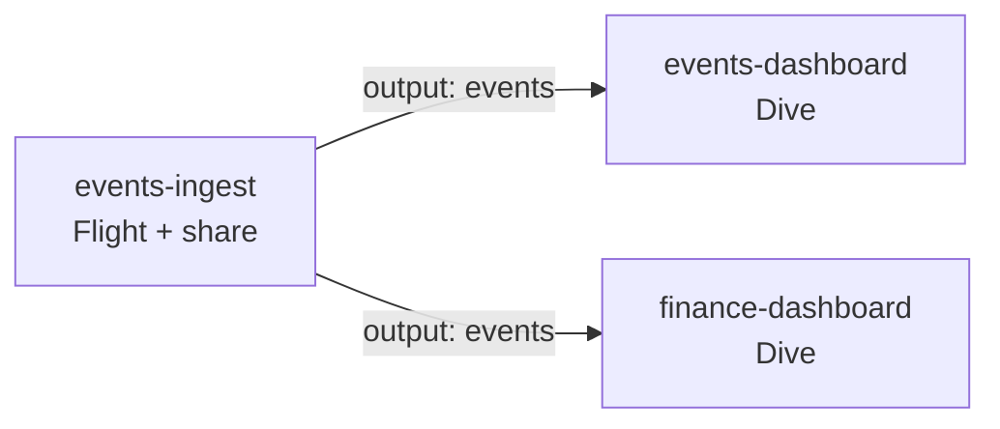

# Repository Reference

Use this page for the repository layout, dependency behavior, targets, and local commands.

## What a customer needs

A fresh repository contains the Wikipedia Flight and Dive, optional examples, documentation, and the workflow/preview support files. You edit `motherduck.yml`, each package's `blueprint.yml`, and its source. Other resource roots are created on demand. There is no need to create empty folders. The files in `.github/workflows/` declare when to run versioned Blueprints workflows. Their deployment jobs and third-party action dependencies live in the tooling repository and are updated with `make upgrade`.

Local source filenames are flexible: `main.py` or `index.tsx` pulled by the MotherDuck CLI can be referenced directly without adding a `src/` layer.

For existing account resources, use `make install-deploy` and `make export`, then follow [adoption](adopt-existing-resources.md). Files from native `pull` commands alone do not include Blueprints deployment manifests.

## Supported Layouts

```text
motherduck.yml
flights/
  <producer-name>/
    blueprint.yml
    src/flight.py
dives/
  <dive-name>/
    blueprint.yml
    src/dive.tsx
guides/
  <guide-name>/
    blueprint.yml
    guide.md
roles/
  <role-name>/
    blueprint.yml
projects/
  <project-name>/
    blueprint.yml
schemas/v1/
```

`motherduck.yml` is the repository catalog and policy file. The template discovers manifests recursively:

```yaml
include:
  - flights/**/blueprint.yml
  - dives/**/blueprint.yml
  - guides/**/blueprint.yml
  - roles/**/blueprint.yml
  - projects/**/blueprint.yml
  - blueprints/**/blueprint.yml
```

The final entry preserves compatibility with existing repositories. No migration is required. Include patterns must stay inside the repository, overlapping matches are deduplicated, and blueprint names are globally unique.

## Package Boundaries

Every leaf package is independently deployable. Use:

- `flights/` for one or more Flights plus the shares and outputs they produce.
- `dives/` for one or more Dives and their declared inputs.
- `guides/` for one or more version-controlled Guides.
- `roles/` for production custom roles and direct memberships.
- `projects/` for any resource combination that genuinely ships, previews, and rolls back together.
- `shared/` for human-oriented shared documentation or configuration only. It has no deployment semantics.

Nested team or domain directories are allowed. In canonical roots, the directory immediately containing `blueprint.yml` must match the blueprint's lowercase slug. Typed roots reject mismatched resource groups. Custom include roots and legacy `blueprints/` packages remain unconstrained.

Resource source files must remain inside their package, including after symlink resolution.

## Inputs, Outputs, and Deployment Graph

A producer gives a package-local share a stable contract name:

```yaml
outputs:
  pageviews:
    share: pageviews
```

A same-repository consumer references that contract:

```yaml
inputs:
  pageviews:
    blueprint: wikipedia-pageviews-ingest
    output: pageviews

resources:
  dives:
    dashboard:
      requiredResources:
        - input: pageviews
          alias: wikipedia_pageviews
```

Inputs can also be used in templates through `${inputs.<name>.*}`. Rendered metadata includes the producer and output identity plus the target-specific share name, database, access, and visibility. Use a literal `url` required resource for a share owned by another repository.

The CLI validates missing producers, missing outputs, outputs pointing to missing shares, self-references, and dependency cycles before deployment.

Selection follows the graph. In this repository, two Dives read the share of one Flight package:



| Change in a pull request | Preview deploys | Merge deploys to production |
| --- | --- | --- |
| `events-ingest` | `events-ingest` and both Dives | `events-ingest` and both Dives |
| `events-dashboard` | `events-dashboard` and `events-ingest`, so the preview has data | `events-dashboard` only |

The rules behind the table:


- Preview expands recursively downstream, then adds every producer those packages read so the branch-scoped preview has its data. Other consumers of those producers are unchanged and are not previewed. Changing one Dive previews that Dive and its producers, not every Dive that reads the same share.
- Production expands downstream only. Changing a producer redeploys its consumers; changing only a consumer uses the existing production output and does not rerun its producer.
- Deployment order is deterministic and producer-first.
- Preview cleanup reverses dependency order and removes deployed Guides before Dives, Flights, shares, and databases.

Direct Git change detection remains package-based. Graph expansion happens when plan, deploy, or cleanup interprets the selected names.

## Targets and Safety

The required targets are:

- `preview`: branch-scoped names, disabled Flight schedules, and cleanup enabled.
- `prod`: stable names deployed through the `motherduck-production` GitHub Environment.

`staging` is the one optional conventional target. Its presence changes CI/CD from direct production deployment to release promotion: previews and `main` use the staging service account, while published releases use production.

Cleanup-sensitive preview shares and databases must contain `${target.branch_slug}` as a whole `_`-separated part. Preview Flight names and Dive titles must contain the branch or branch slug. Cleanup refuses identifiers that are not branch-scoped or that match production.

A target declares the GitHub Environment that holds its service-account token and documents that identity:

```yaml
targets:
  prod:
    mode: production
    environment: motherduck-production
    deployment:
      tokenEnvVar: MOTHERDUCK_TOKEN
      identity: GitHub Actions production service account
```

Tokens are passed to the DuckDB connection and are never printed.

The default `preview + prod` topology points both targets at `motherduck-production` and deploys `main` directly to production. To isolate production, add `staging`, point both `preview` and `staging` at `motherduck-staging`, and keep `prod` on `motherduck-production`. Each GitHub Environment contains its own secret named `MOTHERDUCK_TOKEN`.

Staging and production may render the same database names because the databases belong to different service accounts. Their share names must differ; Blueprints validates this across every rendered share when staging is configured. A `_staging` suffix is the default scaffold convention. Use a customer-specific logical prefix to reduce the chance of a collision outside the repository.

### Adapt the defaults to your organization

The template's names are conventions, not requirements:

- **GitHub Environments.** The workflows read each target's `environment` from `motherduck.yml`. Rename `motherduck-production` or `motherduck-staging` to match your naming policy, then create environments with the same names in GitHub. Each environment needs its own `MOTHERDUCK_TOKEN` secret.
- **Default branch.** The deploy workflow triggers on pushes to `main`. If your default branch has another name, change both `branches: [main]` entries in `.github/workflows/deploy_blueprints.yaml`.
- **Repository name.** `repository.name` in `motherduck.yml` is available to templates as `${repository.name}`. Set it to your repository name.
- **Resource names.** Put a team or product prefix into share, database, and Flight names (for example `acme_events`). Blueprints can detect collisions between its own targets but not with objects created elsewhere in your organization.
- **Organization and region.** The service-account token selects the MotherDuck organization and its region. Blueprints has no separate region setting.
- **Other tools.** If you manage accounts, tokens, roles, or shares with Terraform, give each object one owner. See [use with Terraform](use-with-terraform.md).

## Local Commands

```bash
make setup
make validate
make new-flight events-ingest
make new-dive events-dashboard INPUT=events-ingest.data
make new-guide analytics-guide
make guides
make init-guides
make update-guides
make new-role analytics-team
make new-project revenue-overview
make preview wikipedia-pageviews
make preview-smoke wikipedia-pageviews
make render-preview wikipedia-pageviews
make sync-preview

make plan                                     # production, every package
make plan BRANCH=feature/local NAME=wikipedia-pageviews
make verify
.venv/bin/md-blueprints cleanup --dry-run --target preview --branch feature/local
make doctor
```

`make help` lists the targets by task, and `.venv/bin/md-blueprints --help` lists the CLI commands the same way. `make plan` and `make verify` read MotherDuck without changing it and need the target's `MOTHERDUCK_TOKEN` in the environment; supply it through a secret manager. Both accept `TARGET=<target>`, `BRANCH=<branch>` for a preview, and `NAME=<package>`. `make validate`, `make render-preview`, and `make preview-smoke` never contact MotherDuck.

Omit `--blueprints` to select all packages; an explicitly empty selection is an error. `plan`, `deploy`, `verify`, and `render` use `prod` unless `--target` is given; `--branch` alone selects `preview`, and `--branch` with any other target is an error, so a branch name never reaches a stable target. `doctor` validates all declared targets, including rendered resources, and exits unsuccessfully if the manifest is missing or validation fails. Preview commands preserve the existing Dive entrypoint if source selection fails.

Commands that take a name accept it as the second word or as `NAME=`, for example `make new-flight NAME=events-ingest`. Names are lowercase slugs that use `a-z`, `0-9`, and single hyphens between words, for example `events-ingest`. `make new-blueprint NAME` is deprecated: it still works as an alias for `make new-project NAME` and prints a notice. For a Dive backed by another repository, use `make new-dive NAME URL=md:_share/...`. If a package declares several Dives, pass `DIVE=<resource-key>` to preview commands.

`make guides` prints a read-only context brief for an agent to author Markdown Guides. Pass `DBT="/path/to/project"` to add dbt YAML documentation and relationship hints. `make init-guides` and `make update-guides` select the corresponding agent task, with the same discovery and no file writes. See [Guides as code](guides-as-code.md).

Customer repositories include a manual **Prepare Guide context** workflow. It uploads the same brief as a `guide-context` artifact for an agent to consume. The composite action supports `command: guides`, a named `dbt` input, and a `stdout-file` output. See [Guide CI integration](github-action.md#prepare-guides-in-ci) for custom jobs and optional agent authoring.

`make validate` renders every declared target, validates contracts and uniqueness, checks Flight Python syntax and source boundaries, and validates Dive mounts and Guide references. `make plan` queries live state without mutations. A non-selected stable producer must already expose its declared share or planning fails before deployment.

## Dives

Preview Dives use `draft`. A Dive that omits `status` gets `draft` in preview; a Dive with another base `status` needs `targets.preview.status: draft`, or preview validation fails. Production manifests can declare `draft`, `ready`, `endorsed`, or `archived`; omitting `status` preserves the live value during content updates. Deployment plans show current and desired status, and endorsement requires an organization-admin identity.

A deployed Dive is owned by the deployment identity. Other people open it through a `read` grant: MotherDuck gives a new Dive one for the whole organization, or none where the organization starts Dives private. Declare the audience with the Dive's [`grants`](blueprint-yml-reference.md#dives) to manage it from the repository. A grant on the Dive does not include its data, so the same audience needs `READ` on the shares the Dive mounts.

Dive source imports from `@motherduck/react-sql-query` only what production Dives provide: `useSQLQuery`, `useExport`, `useDiveState`, `useRunFlight`, `useFlightRun`, `quoteSqlIdentifier`, and `quoteSqlString`. The other importable libraries are React 18.3.1, d3 7.9.0, lucide-react 0.468.0, and recharts 3.7.0, with Tailwind CSS 3.4.17 classes. The local preview pins the same versions, and `make preview-smoke` fails on any other import from the SDK. `useRunFlight` and `useFlightRun` start and follow a Flight run by UUID. Any viewer of a Dive can start a Flight that they own or hold a `run` grant on, so give the Dive's audience a grant with the Flight's [`grants`](blueprint-yml-reference.md#flights). A viewer who is not the Flight's owner or an organization admin can follow only the runs they started. Blueprints does not substitute Flight IDs into Dive source: a Dive that names a Flight by UUID runs that Flight from every target, including previews, so point it at a Flight that is safe to run from a preview. The local preview runs Flights with your token, so it can run a Flight only when you own it or hold a grant.

## Guides

Declare Guide assets with `resources.guides`. They remain source-validation-only by default; `deploy: true` enables create, version, metadata, access, reference, and preview-cleanup lifecycle management. Organization-wide Guides require an admin deployment identity. `resources.context` is deprecated. It is still accepted for validation only. Rename it to `resources.guides`.

See [Manage Guides as code](guides-as-code.md) for the end-to-end workflow, including branch-scoped previews and repository resource references.

## RBAC

Declare custom roles under `resources.roles` or scaffold a role package with `make new-role`. Roles deploy to stable staging and production targets, but never to preview, before resources that may grant access to them. Share `grants` can target roles and users, and Flight `grants` can also target the whole organization, in additive or authoritative mode. Role and organization-Guide changes run an admin capability preflight before the first mutation.

## CI/CD

The generated workflows call versioned reusable workflows. The targets in `motherduck.yml` decide where each event deploys:

```mermaid
flowchart TB
  subgraph default["Default: preview and prod"]
    d_pr["Pull request"] --> d_prev["Preview<br/>production account"]
    d_main["Push to main"] --> d_prod["Production"]
  end
  subgraph staged["With a staging target"]
    s_pr["Pull request"] --> s_prev["Preview<br/>staging account"]
    s_main["Push to main"] --> s_stg["Staging"]
    s_rel["Published release"] --> s_prod["Production"]
  end
```

What each event does:

| Event | Without staging | With staging |
| --- | --- | --- |
| Pull request | Deploys a branch-scoped preview | Deploys a preview with the staging service account |
| Push to `main` | Deploys production | Deploys staging |
| Published non-prerelease GitHub Release | Nothing | Verifies the tag is on the default branch, then deploys production |
| Pull request closed or branch deleted | Cleans up the preview | Cleans up the preview |

Pull requests:

- The workflow computes the directly changed packages, expands the preview dependency graph, plans live changes, and deploys branch-scoped resources.
- The pull request comment lists the selected packages, any packages the dependency graph added, and preview links. The verified resource table is folded in the comment.
- The full plan is in the workflow run summary, also when the plan fails. When the plan or the deploy fails, the comment says so instead of keeping the previous preview's report.
- Cleanup runs in dependency-safe order through the preview target's GitHub Environment.

Pushes to `main`:

- Each push deploys only the packages it changed, plus their downstream consumers.
- Stable deploys run one at a time and every queued run deploys in order. A newer push never replaces a waiting one.
- A deploy that fails is not repeated by the next push. Re-run the failed job, or run **Actions → Deploy Blueprints → Run workflow** for the target, to deploy its packages. The failed run's summary says the same.
- A job that uses the MotherDuck token stops after `timeout-minutes` (120 for deploys, 60 for cleanup). See [customize the reusable workflows](github-action.md#customize-the-reusable-workflows).

## Retire a package

Deleting a package directory removes it from validation and deployment. It does not delete anything in MotherDuck: a scheduled Flight keeps running, and its Dives, Guides, shares, and roles stay live. The deploy log for that push prints a warning that names the package.

1. Before deleting, record the live IDs: run `make plan NAME=<package>` (`.venv/bin/md-blueprints plan --target prod --blueprints NAME`) with the target's token and keep the `ID` column.
2. Remove or repoint the consumers first. Validation fails while another package still declares the retired package as an input or a Guide reference.
3. Delete the package directory and merge the pull request. Previews of the pull request are cleaned up as usual.
4. Delete the live resources with the identity that owns them, in the MotherDuck UI or with SQL. Delete consumers before producers:

   ```sql
   FROM MD_DELETE_GUIDE(id := '<guide id>'::UUID);
   FROM MD_DELETE_DIVE(id = '<dive id>'::UUID);
   FROM MD_DELETE_FLIGHT("flight_id" => '<flight id>'::UUID);
   FROM MD_DROP_DATABASE_SHARE('<share name>');
   ```

   Drop the database and any role only when nothing else uses them. With staging, repeat for the staging account.

Renaming a package directory and its `name` together does not retire it: its resources are matched by `id`, or by Flight name, Dive title, and Guide topic and title.

## Included examples

The [examples index](examples/README.md) lists every example by what it is for.

- [Wikipedia Pageviews](examples/wikipedia-pageviews.md) uses independent Flight and Dive packages connected through a named output and input. It is the active starter.
- [Pageviews Weekly Trends](../examples/pageviews-weekly-trends/README.md) is a SQL transformation project that reads the starter's data through an input.
- [Data Freshness Monitor](../examples/data-freshness-monitor/README.md) is an hourly Flight that records checks and fails when data is stale.
- [Pageviews Guide](../examples/pageviews-guide/README.md) is a Guide package with catalog, Flight, and Dive references.
- [NCS Field Recovery Explorer](examples/ncs-field-recovery.md) keeps its Flight, share, and Dive in one project because they deploy and roll back together.
