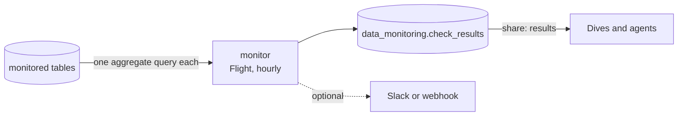

# Data Freshness Monitor

A scheduled Flight that checks, every hour, that the tables you depend on are fresh and non-empty. It records every result in a table and fails the run when a check fails, so a stale pipeline is visible in MotherDuck before a dashboard viewer notices it.



## Resources

- Flight `monitor`: runs at the start of every hour on the smallest runner (`F4`).
- Share `results`: the `data_monitoring` database, exported as the `results` output.

## Tables and view

- `check_results`: one row per check and run, with `status`, `row_count`, `age_hours`, `problems`, and the Flight run ID.
- `latest_check_results`: the newest row per checked table.

## Configure the checks

`config.checks` in `blueprint.yml` is a JSON array. Each check names a table as `database.schema.table`:

```yaml
checks: >-
  [{"table": "${inputs.pageviews.database}.main.pageviews_daily",
  "timestamp_column": "loaded_at_utc", "max_age_hours": 30, "min_rows": 1},
  {"table": "sales.main.orders", "timestamp_column": "updated_at", "max_age_hours": 2}]
```

| Key | Meaning |
| --- | --- |
| `table` | Required. The deployment identity must be able to read it. |
| `min_rows` | Fails when the table has fewer rows. |
| `timestamp_column` | Column that holds the load or event time. Required with `max_age_hours`. |
| `max_age_hours` | Fails when the newest value in `timestamp_column` is older. |

A table that cannot be queried is recorded as a failed check and does not stop the other checks.

## Send alerts

A failed run is visible in the Flight's run history without any setup. To also post a message, create a Flight secret named `alert_webhook` with the key `URL` in **MotherDuck → Settings → Secrets**, then list it in the manifest:

```yaml
secrets: [alert_webhook]
```

The Flight reads it as `alert_webhook_URL` and posts `{"text": "..."}`, the format Slack incoming webhooks accept. Never put the URL in `config`: config values are visible to anyone who can run the Flight.

## Patterns to reuse

- **Fail loudly.** A non-zero exit marks the run as failed. Set `fail_on_alert: "false"` to record problems without failing.
- **Do not block deploys on data.** `runOnDeploy: true` creates the results table on the first deploy, and `waitForRun` is left unset so stale data fails the monitor run and not the deployment.
- **Treat config as input.** Whoever starts a run can override config, so the Flight validates every identifier before it reaches SQL.
- **Size the runner to the work.** Every check runs in MotherDuck, so `F4` is enough.
- **Keep the history.** Results are appended in one statement per run. A Dive that mounts the `results` output can chart them.

## Enable the example

The default check reads the `wikipedia-pageviews-ingest` starter.

```bash
mkdir -p flights
cp -R examples/data-freshness-monitor flights/data-freshness-monitor
make validate
```

Open a pull request to deploy a preview. The preview checks the preview copy of the source, runs once, and has no schedule.
