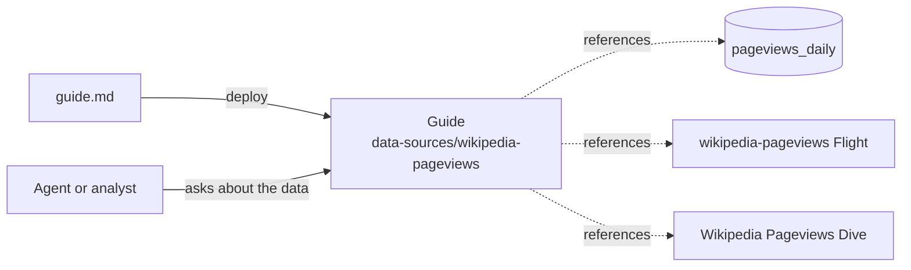

# Wikipedia Pageviews Guide

A Guide package. It deploys Markdown that tells agents and collaborators how to query the dataset that `wikipedia-pageviews-ingest` loads: the grain of each table, what the columns mean, the rules that prevent wrong answers, and query patterns to copy.

An agent connected to MotherDuck, for example through the MotherDuck MCP server, finds the Guide when it looks up the table, the Flight, or the Dive, because the manifest references all three.



## Files

- `blueprint.yml`: title, topic, access, and the references.
- `guide.md`: the content.

## Patterns to reuse

- **One Guide per dataset, under `data-sources/`.** Describe the source, the refresh, the grain of each table, the columns, and the caveats.
- **Write rules, not prose.** State what double-counts, what is missing, and which filter is required. An agent follows explicit rules.
- **Include queries that run.** Use the alias that readers attach the share under.
- **Reference what the Guide describes.** Catalog references point at tables and views; Flight and Dive references point at the resources in other packages.
- **Cite sources in the repository.** The last section names the files a reviewer can check the Guide against.
- **Start private.** `access: user` needs no special permission. Change it to `organization` when the content is reviewed and the deployment identity has the `admin` role.
- **Review it like code.** A pull request deploys a preview Guide under a branch-scoped topic, and a new version is appended only when the content or references change.

## Enable the example

The example needs the `wikipedia-pageviews-ingest` and `wikipedia-pageviews` starter packages.

```bash
mkdir -p guides
cp -R examples/pageviews-guide guides/pageviews-guide
make validate
```

To write Guides for your own data, run `make guides` and follow [Guides as code](../../docs/guides-as-code.md).
