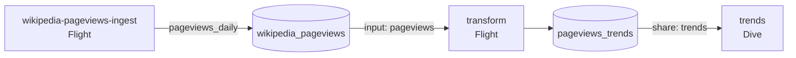

# Pageviews Weekly Trends

A SQL transformation project. A scheduled Flight reads the daily table that `wikipedia-pageviews-ingest` loads, rebuilds weekly reporting tables in its own database, publishes them as a share, and a Dive shows the result.

Use it as the starting point for the most common pipeline shape after ingestion: raw data in one database, reporting tables in another, a dashboard on top.



## Resources

- Flight `transform`: runs daily at 06:47 UTC, 30 minutes after the ingest, and once on every deploy.
- Share `trends`: the `pageviews_trends` database, exported as the `trends` output.
- Dive `trends`: reads the share under the alias `pageviews_trends`.

## Tables and view

- `weekly_pageviews`: one row per project, article, and ISO week (Monday start), with `views`, `days_loaded`, and `is_complete_week`.
- `article_trends`: complete weeks only, with `previous_week_views`, `week_over_week_pct`, and `four_week_average`.

## Patterns to reuse

- **Declare what you read.** The package lists the ingest output under `inputs`, and the Flight receives the database name as `${inputs.pageviews.database}`. Blueprints then deploys the producer first, and a pull-request preview reads the preview copy of the source instead of production.
- **Replace, do not append.** Each run rebuilds the table with `CREATE OR REPLACE TABLE ... AS`. A rerun gives the same result, and a failed run leaves the previous table in place.
- **Check the source before replacing.** The Flight exits with an error when the source is empty, so a broken upstream load cannot blank the dashboard.
- **Keep the work in SQL.** The Flight sends statements to MotherDuck and never pulls rows into Python.
- **Do not name the database inside a view.** The Flight runs `USE <database>` and the view refers to `main.weekly_pageviews`. Readers attach a share under their own alias, so a view that names its database breaks for them.
- **Attach only what the Flight uses.** It connects with `attach_mode=single` and attaches the source database explicitly.
- **Publish at the end.** One `UPDATE SHARE` after the last write makes the new tables visible to the Dive.
- **Show the steps.** `src/chart.mmd` and the `@flight-run` lines give the run a step-by-step view in MotherDuck.

## Enable the example

The example needs the `wikipedia-pageviews-ingest` package, which ships as the starter.

```bash
mkdir -p projects
cp -R examples/pageviews-weekly-trends projects/pageviews-weekly-trends
make validate
make preview-smoke NAME=pageviews-weekly-trends
```

Open a pull request to deploy a preview. To transform your own data, change the `inputs` entry and the SQL in `src/flight.py`.

## When to split it

This package owns the Flight, the share, and the Dive, so they deploy together. Move the Dive to `dives/` with an input on the `trends` output when a different team owns the dashboard.
